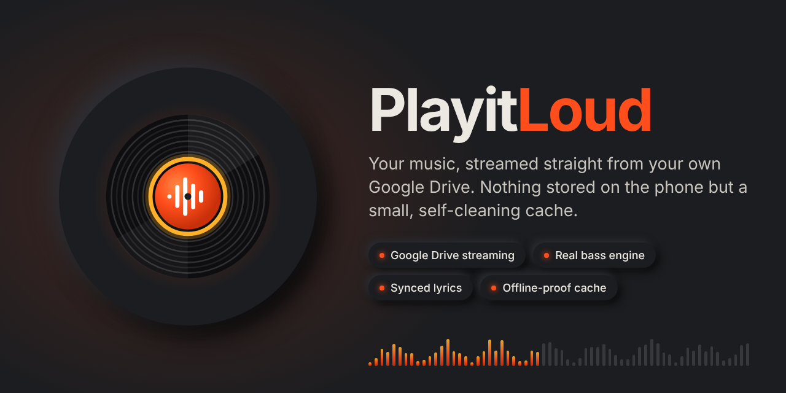
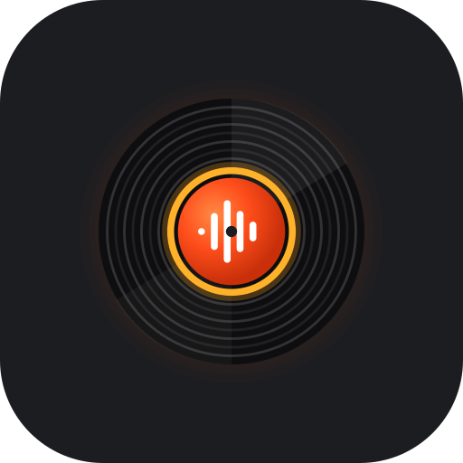
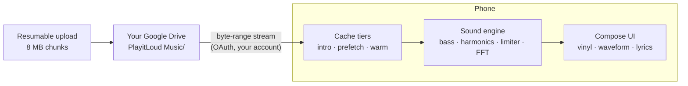

<p align="center">
  
</p>

<p align="center">
  <br>
  <strong>An Android music player that streams from your own Google Drive.</strong><br>
  No server, no subscription, no music stored on the phone beyond a small self-cleaning cache.<br>
  <a href="https://sankettheinventor.github.io/PlayitLoud/">Website</a> · <a href="https://sankettheinventor.github.io/PlayitLoud/#docs">Setup guide</a>
</p>

<p align="center">
  
  
  
  
</p>

---

## Why PlayitLoud

Streaming apps rent you music. Local players fill your phone. PlayitLoud does neither: your songs live in **your own Google Drive**, and the app streams them on demand with byte-range requests. A three-tier cache makes playback feel local. The next song is already downloaded and your recent songs replay instantly, and playback keeps going through short connection drops.

## Features

- **Streams from Google Drive.** Every folder in `PlayitLoud Music` is a playlist. A 500 MB FLAC starts as fast as a 3 MB MP3.
- **Smart cache, not a library on the phone.** It holds the first seconds of every song, the full next song and your last 10 songs, capped at 512 MB and cleaned automatically.
- **Real bass engine.** A bass knob (−12 to +12 dB), frequency (40–160 Hz), *Punch* (virtual-bass harmonics for phone speakers), preamp, a smooth limiter and a live FFT spectrum. Presets: Flat, Warm, Deep, Club, Speaker.
- **A player that moves with the music.** A spinning vinyl with reactive rings, and a waveform seek bar that learns each song's shape as you listen.
- **Synced lyrics.** Drop a `.lrc` file next to the song.
- **Uploads of any size.** Resumable 8 MB chunks continue after a dropped connection, a killed app or a reboot.
- **Small.** About 2 MB with R8 shrinking.

**Formats:** MP3, M4A/AAC, MP4 audio, FLAC, WAV, OGG/Vorbis, Opus, AMR, MKA/WebM, MIDI.

## How it works



| Cache tier | Where | Holds | Cleared |
|---|---|---|---|
| Hot | RAM | Current song and buffer | Always |
| Prefetch | Phone cache | The entire next song in the queue | At session end |
| Intro | Phone cache | First ~10 s of every song in playlists you open | Kept |
| Warm | Phone cache | Your last 10 played songs, in full | Least recently used first |
| Index | Phone files | Library structure and lyrics (tiny) | Kept |
| Library | Google Drive | All songs | Never |

## Privacy and security

- **Your music never leaves your Drive account.** The app talks only to Google's APIs (`googleapis.com`). There is no PlayitLoud server, no analytics and no tracking.
- **Nothing secret is in this repository.** No signing key, no client ID, no token. Google identifies your copy of the app by its package name and **your** signing key's SHA-1, which you register in **your** Google Cloud project.
- **Sign-in uses Google's own account picker.** The access token stays in memory on the phone and is refreshed silently.
- **Permissions:** internet, network state, notifications and foreground playback. No storage, contacts, location, camera or microphone permissions.

## Run your own copy

You need a Google account and either GitHub (to build in the cloud) or Android Studio. It takes about 15 minutes.

### 1. Create your signing key

On any computer with Java installed:

```sh
keytool -genkeypair -v -keystore playitloud.jks -alias playitloud \
  -keyalg RSA -keysize 4096 -validity 10000
keytool -list -v -keystore playitloud.jks -alias playitloud | grep SHA1
```

Keep `playitloud.jks` and its passwords private, and **never commit them**. `.gitignore` already blocks `*.jks` and `*.keystore`. Note the **SHA-1** line.

### 2. Set up Google Cloud

1. In the [Google Cloud console](https://console.cloud.google.com), create a project and enable the **Google Drive API**.
2. Open **Google Auth Platform** and create the consent screen: External, publishing status **Testing**. Add your Gmail under **Test users**.
3. Under **Data Access**, add the scope `https://www.googleapis.com/auth/drive`.
4. Under **Clients**, create an **Android** client with package name `dev.wave.player` and **your SHA-1** from step 1.

No client ID or secret goes into the code.

### 3a. Build in the cloud with GitHub Actions (no laptop needed)

1. Fork this repository.
2. In your fork, go to **Settings → Secrets and variables → Actions** and add four repository secrets:

   | Secret | Value |
   |---|---|
   | `PLAYITLOUD_KEYSTORE_BASE64` | Output of `base64 -w0 playitloud.jks` (macOS: `base64 -i playitloud.jks`) |
   | `PLAYITLOUD_KEYSTORE_PASSWORD` | Your keystore password |
   | `PLAYITLOUD_KEY_ALIAS` | `playitloud` |
   | `PLAYITLOUD_KEY_PASSWORD` | Your key password |

3. Push to `main`, or run **Actions → Build APK → Run workflow**. The signed APK appears under **Releases → latest** in your fork.
4. On your phone, download `playitloud.apk` and allow "Install unknown apps" for your browser when asked.

Without the secrets the workflow still builds, signed with a throwaway debug key, and keeps the APK as a workflow artifact only. Google sign-in won't work with that build.

### 3b. Build with Android Studio

```sh
export PLAYITLOUD_KEYSTORE_PATH=/path/to/playitloud.jks
export PLAYITLOUD_KEYSTORE_PASSWORD=...
export PLAYITLOUD_KEY_ALIAS=playitloud
export PLAYITLOUD_KEY_PASSWORD=...
```

Open the project in Android Studio (Ladybug or newer), connect your phone with USB debugging on, and press **Run**. If you skip the variables, the build uses your machine's own debug key; register *that* SHA-1 in step 2 instead (`keytool -list -v -keystore ~/.android/debug.keystore -alias androiddebugkey -storepass android`).

### 4. Use it

Tap **Connect Google Drive** and pick your test Gmail. On "Google hasn't verified this app", tap **Continue**, which is normal in Testing mode. The app creates this folder in your Drive:

```
PlayitLoud Music/         -> playlist "Library"
  Song A.mp3
  Song A.lrc              -> synced lyrics (same name as the song)
  Road Trip/              -> playlist "Road Trip" (every subfolder is a playlist)
    Song B.flac
```

Add songs with **Add songs** in the app, or drop files into these folders from Drive on any device and tap refresh.

> In Testing mode, Google asks you to approve access again about once a week. Distributing the app to other people requires Google's app verification for the Drive scope.

## Code map

```
auth/GoogleAuth.kt         Drive sign-in, silent token refresh
drive/DriveApi.kt          Drive REST: folders, listing, lyrics, resumable upload
library/Library.kt         Songs, playlists, local index
lyrics/Lyrics.kt           .lrc parser and lyrics cache
cache/MediaCache.kt        Intro / prefetch / warm tiers and session sweep
playback/PlaybackService   Background player (Media3) with the Drive data source
playback/SoundEngine.kt    Bass engine (shelf, harmonics, limiter) and FFT spectrum
playback/WaveformStore.kt  Per-song waveform learnt while playing
upload/UploadWorker.kt     Chunked, resumable upload of any size
ui/                        Neumorphic Compose UI: library, player, sound, lyrics
```

**Stack:** Kotlin, Jetpack Compose (Material 3), Media3 ExoPlayer and Session, WorkManager, OkHttp, kotlinx.serialization, Google Play services auth. Minimum Android 8.0 (API 26), target API 35.

## Roadmap

- **Instrument layers:** loops mixed in sync with the song.
- **iPhone version:** the Drive, cache, library and lyrics logic moves into a shared Kotlin Multiplatform module, with an AVAudioEngine audio path on iOS.

## Author

Built by [Sanket Toraskar](https://github.com/sankettheinventor).
